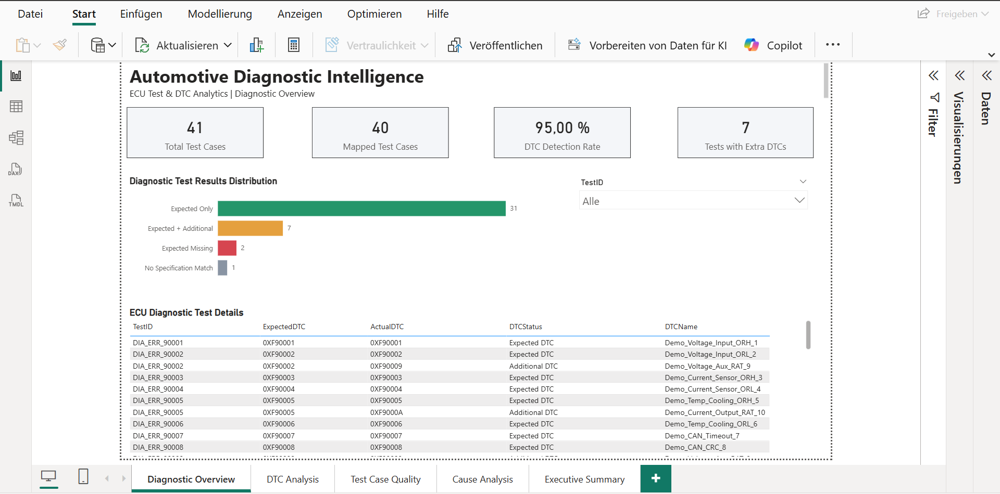
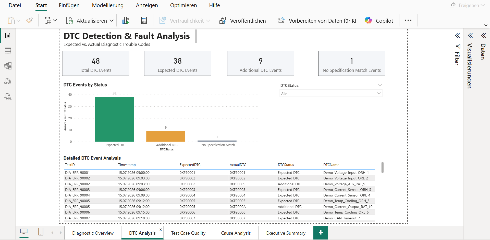
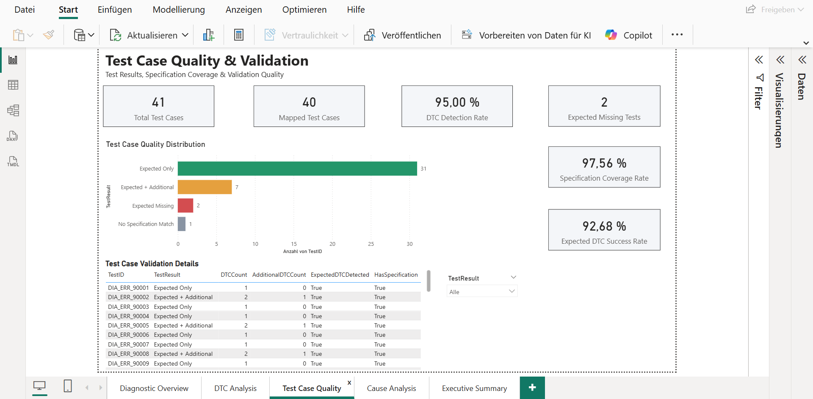
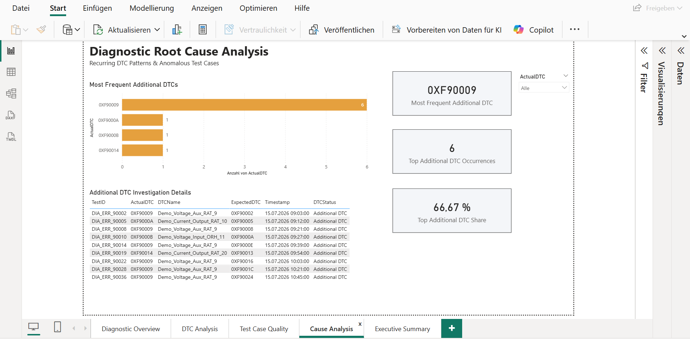
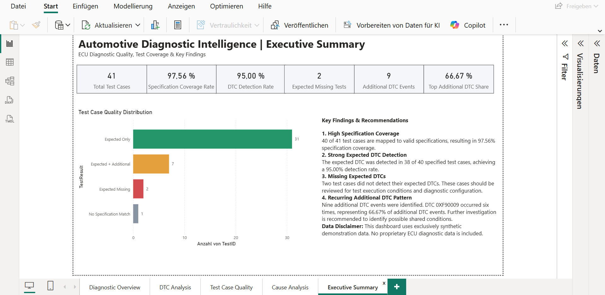

# **Automotive Diagnostic Intelligence**

## **ECU Test & DTC Analytics | Power BI Portfolio Project**

### **Project Overview**

This project demonstrates an end-to-end Business Intelligence solution for analyzing automotive Electronic Control Unit (ECU) diagnostic test results using Microsoft Power BI.

The solution transforms synthetic diagnostic event logs and test specifications into an interactive dashboard for diagnostic quality monitoring, test coverage analysis, and anomaly investigation.

**All data is synthetic and intended for demonstration purposes only. No proprietary ECU diagnostic data is included.**

### Dashboard Preview

#### 1. Diagnostic Overview

#### 2. DTC Analysis

#### 3. Test Case Quality

#### 4. Root Cause Analysis

#### 5. Executive Summary

### **Technologies Used**

* Microsoft Power BI  
* Power Query (M)  
* DAX  
* Data Modeling  
* JSON and Excel  
* Data Quality Analysis  
* Git and GitHub

### **Dashboard Pages**

| Page | Description |
| ----- | ----- |
| 01 – Diagnostic Overview | Overall test performance and diagnostic KPIs |
| 02 – DTC Analysis | Expected versus actual diagnostic trouble codes |
| 03 – Test Case Quality | Specification coverage and validation results |
| 04 – Root Cause Analysis | Investigation of recurring additional DTC patterns |
| 05 – Executive Summary | Management-level KPIs, findings and recommendations |

### **Key Results**

| Metric | Value |
| ----- | ----- |
| Total Test Cases | 41 |
| Specification Coverage | 97.56% |
| Expected DTC Detection Rate | 95.00% |
| Expected Missing Tests | 2 |
| Additional DTC Events | 9 |
| Most Frequent Additional DTC | 0XF90009 |
| Share of Top Additional DTC | 66.67% |

### **Data Processing**

1. Import synthetic ECU diagnostic events from JSON.  
2. Import synthetic test specifications from Excel.  
3. Standardize test identifiers and diagnostic trouble codes.  
4. Merge actual diagnostic events with expected DTC specifications.  
5. Classify diagnostic results.  
6. Aggregate test-level KPIs.  
7. Create interactive Power BI dashboards using DAX and data modeling.

### **Dataset**

The project uses two synthetic data sources:

* `data/Synthetic_DTC_Events.json`  
* `data/Synthetic_TestSpecification_Clean.xlsx`

No real ECU logs or proprietary test specifications are required.

### **How to Run the Project**

1. Download or clone this repository.  
2. Open `powerbi/Automotive_Diagnostic_Public_Clean.pbip` using Power BI Desktop.  
3. Open Power Query and locate the parameter `pDataFolder`.  
4. Change its value to the absolute path of the repository's `data` directory, ending with `\`.  
5. Select **Close & Apply** and refresh the semantic model.  
6. Explore the five interactive report pages.

### **Key Findings**

* 40 of 41 test cases have valid specification mappings.  
* The expected DTC was detected in 38 of 40 specified test cases.  
* Two test cases are missing their expected DTC.  
* Nine additional DTC events were identified.  
* DTC `0XF90009` accounts for six additional DTC events.

These observations support further diagnostic investigation but do not establish confirmed technical root causes.

### **Author**

Chancel Nouboussi

**Microsoft Certified:**

* Power BI Data Analyst Associate (PL-300)  
* Fabric Analytics Engineer Associate (DP-600)  
* Azure Data Fundamentals (DP-900)

GitHub: [https\://github.com/Chancel-Nouboussi](https://github.com/Chancel-Nouboussi)

### **Disclaimer**

This project is an independent portfolio demonstration using synthetic data. It does not represent an official automotive manufacturer project.

