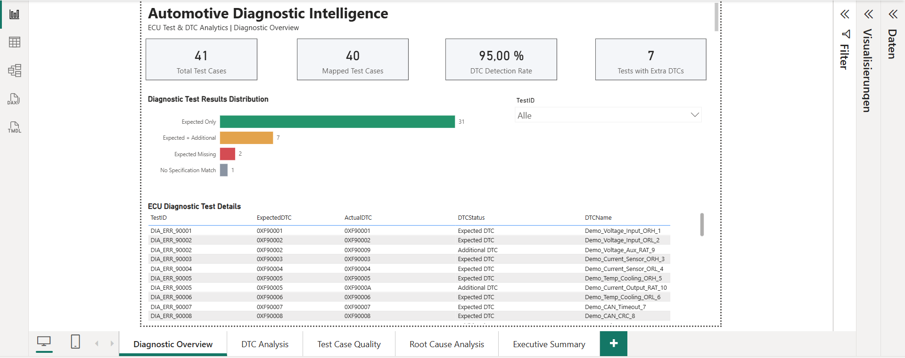
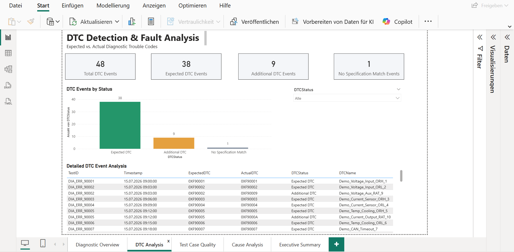
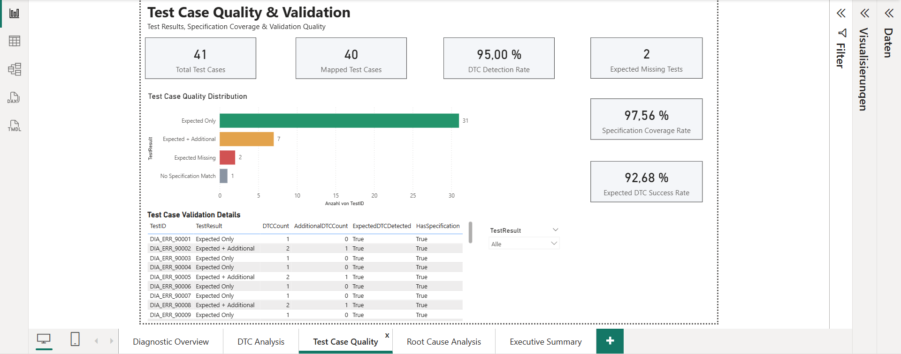
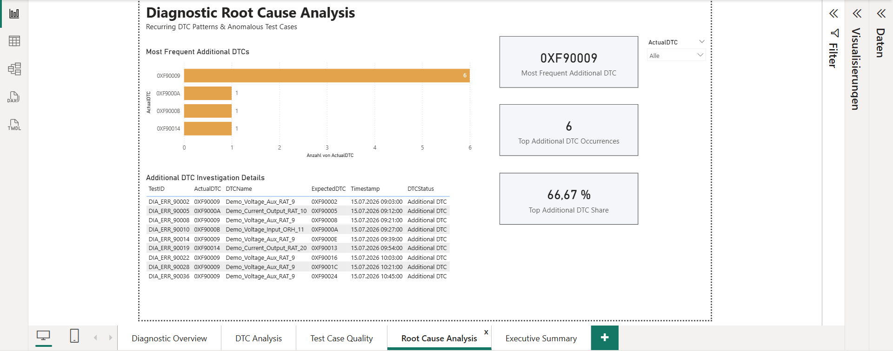
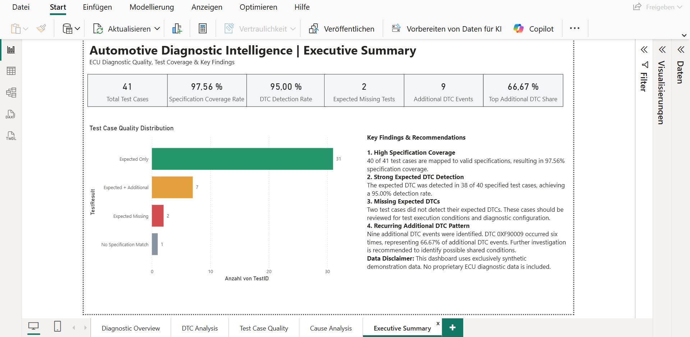

**Language / Sprache:** [English](README.md) | [Deutsch](README_DE.md)

---

# **Automotive Diagnostic Intelligence**

## **ECU Test & DTC Analytics | Power BI Portfolio Project**

### **Project Overview**

This project demonstrates an end-to-end Business Intelligence solution for analyzing automotive Electronic Control Unit (ECU) diagnostic test results using Microsoft Power BI.

The solution transforms synthetic diagnostic event logs and test specifications into an interactive dashboard for diagnostic quality monitoring, test coverage analysis, and anomaly investigation.

**All data is synthetic and intended for demonstration purposes only. No proprietary ECU diagnostic data is included.**

---

## Business Case & Data Storytelling

### From ECU Diagnostic Test Results to Actionable Quality Insights

**The Challenge**

Automotive ECU validation generates diagnostic test results that must be compared with expected behavior defined in test specifications.

Missing expected Diagnostic Trouble Codes (DTCs), additional diagnostic events, and incomplete specification mappings can make it difficult to assess test quality and identify areas requiring investigation.

**My Solution**

I developed a Power BI analytics solution using Power Query, DAX, and a structured data model to combine synthetic ECU diagnostic events with test specifications.

The solution provides five interactive reporting pages covering diagnostic performance, DTC analysis, test case quality, recurring anomalies, and an executive summary.

**Key Findings**

The analysis of the synthetic test dataset revealed:

- 41 diagnostic test cases analyzed.
- 40 of 41 test cases with valid specification mappings (97.56%).
- Expected DTCs detected in 38 of 40 specified test cases (95.00%).
- 2 test cases without their expected DTC.
- 9 additional DTC events identified.
- DTC `0XF90009` responsible for 6 of the 9 additional events (66.67%).

**From Findings to Action**

The analysis highlights three areas for further investigation:

1. Review the test case without a valid specification mapping to improve specification coverage.
2. Investigate the two test cases with missing expected DTCs to understand possible diagnostic or test-execution deviations.
3. Prioritize examination of the recurring additional DTC `0XF90009` and its associated test conditions.

These findings indicate investigation priorities but do not establish confirmed technical root causes.

**Business Value**

This project demonstrates how interactive analytics can help engineering and validation teams monitor diagnostic quality, identify recurring anomalies, prioritize investigations, and communicate technical findings to stakeholders.

It combines automotive software-testing knowledge with business intelligence and the development of analytical tools.

*All datasets and findings are synthetic and intended for portfolio demonstration. No improvements in real-world vehicle quality or engineering efficiency have been measured.*

### Dashboard Preview

#### 1. Diagnostic Overview

#### 2. DTC Analysis

#### 3. Test Case Quality

#### 4. Root Cause Analysis

#### 5. Executive Summary

### **Technologies Used**

* Microsoft Power BI  
* Power Query (M)  
* DAX  
* Data Modeling  
* JSON and Excel  
* Data Quality Analysis  
* Git and GitHub

### **Dashboard Pages**

| Page | Description |
| ----- | ----- |
| 01 – Diagnostic Overview | Overall test performance and diagnostic KPIs |
| 02 – DTC Analysis | Expected versus actual diagnostic trouble codes |
| 03 – Test Case Quality | Specification coverage and validation results |
| 04 – Root Cause Analysis | Investigation of recurring additional DTC patterns |
| 05 – Executive Summary | Management-level KPIs, findings and recommendations |

### **Key Results**

| Metric | Value |
| ----- | ----- |
| Total Test Cases | 41 |
| Specification Coverage | 97.56% |
| Expected DTC Detection Rate | 95.00% |
| Expected Missing Tests | 2 |
| Additional DTC Events | 9 |
| Most Frequent Additional DTC | 0XF90009 |
| Share of Top Additional DTC | 66.67% |

### **Data Processing**

1. Import synthetic ECU diagnostic events from JSON.  
2. Import synthetic test specifications from Excel.  
3. Standardize test identifiers and diagnostic trouble codes.  
4. Merge actual diagnostic events with expected DTC specifications.  
5. Classify diagnostic results.  
6. Aggregate test-level KPIs.  
7. Create interactive Power BI dashboards using DAX and data modeling.

### **Dataset**

The project uses two synthetic data sources:

* `data/Synthetic_DTC_Events.json`  
* `data/Synthetic_TestSpecification_Clean.xlsx`

No real ECU logs or proprietary test specifications are required.

### **How to Run the Project**

1. Download or clone this repository.  
2. Open `powerbi/Automotive_Diagnostic_Public_Clean.pbip` using Power BI Desktop.  
3. Open Power Query and locate the parameter `pDataFolder`.  
4. Change its value to the absolute path of the repository's `data` directory, ending with `\`.  
5. Select **Close & Apply** and refresh the semantic model.  
6. Explore the five interactive report pages.

### **Key Findings**

* 40 of 41 test cases have valid specification mappings.  
* The expected DTC was detected in 38 of 40 specified test cases.  
* Two test cases are missing their expected DTC.  
* Nine additional DTC events were identified.  
* DTC `0XF90009` accounts for six additional DTC events.

These observations support further diagnostic investigation but do not establish confirmed technical root causes.

### **Author**

Chancel Nouboussi

**Microsoft Certified:**

* Power BI Data Analyst Associate (PL-300)  
* Fabric Analytics Engineer Associate (DP-600)  
* Azure Data Fundamentals (DP-900)

GitHub: [https\://github.com/Chancel-Nouboussi](https://github.com/Chancel-Nouboussi)

### **Disclaimer**

This project is an independent portfolio demonstration using synthetic data. It does not represent an official automotive manufacturer project.

