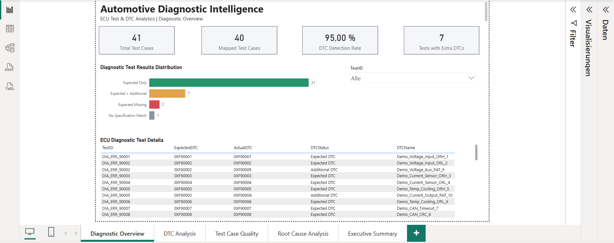
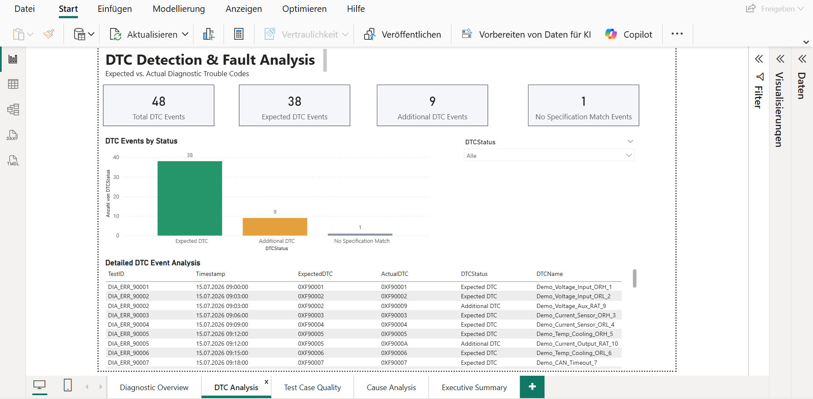
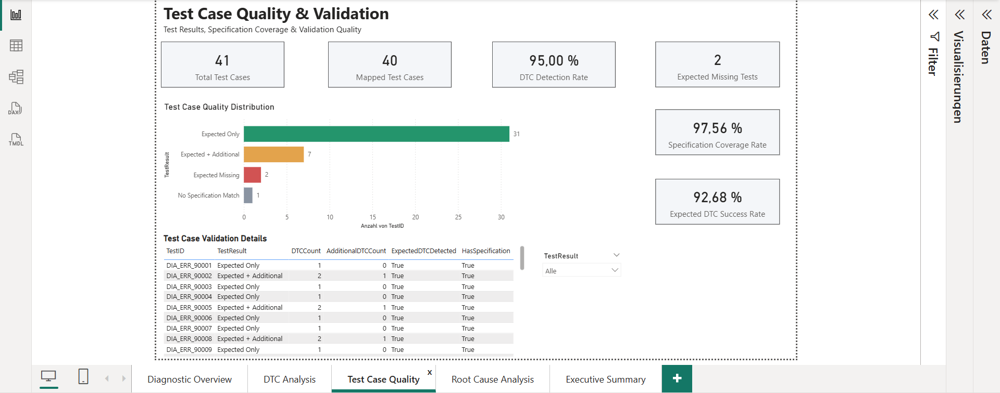
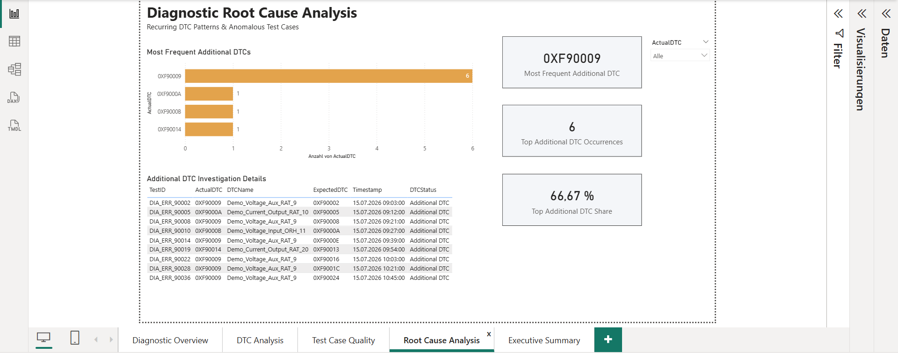
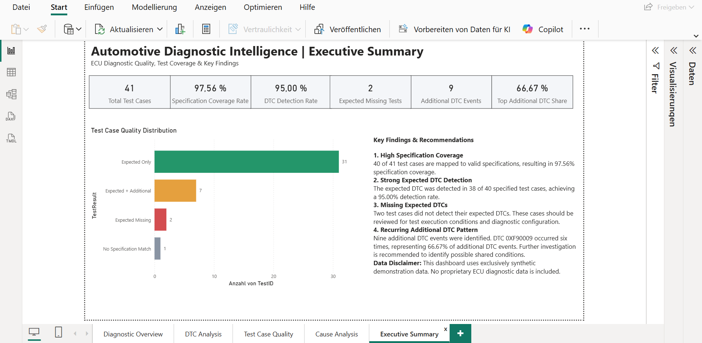

**Sprache / Language:** [Deutsch](README_DE.md) | [English](README.md)

---

# Automotive Diagnostic Intelligence

## ECU-Test- und DTC-Analyse | Power-BI-Portfolio-Projekt

### Projektübersicht

Dieses Portfolio-Projekt demonstriert eine Business-Intelligence-Lösung zur Analyse von Diagnose- und Testergebnissen elektronischer Steuergeräte (ECUs) im Automotive-Bereich mit **Microsoft Power BI**.

Die Lösung verbindet synthetische Diagnoseereignisse im JSON-Format mit einer synthetischen Testspezifikation aus Excel. Daraus entstehen interaktive Berichte zur DTC-Erkennung, Spezifikationsabdeckung, Testfallqualität und Untersuchung wiederkehrender Auffälligkeiten.

> **Datenschutzhinweis:** Sämtliche Datensätze sind synthetisch und ausschließlich für Demonstrationszwecke vorgesehen. Die gezeigten Ergebnisse repräsentieren keine realen Fahrzeug- oder Unternehmensdaten.

---

## Business Case & Data Storytelling

### Von Fahrzeugdiagnose-Testdaten zu aussagekräftigen Qualitätsanalysen

**Die Herausforderung**

Bei der Entwicklung und Validierung von Fahrzeugsteuergeräten entstehen umfangreiche Diagnose- und Testergebnisse. Diese müssen mit dem erwarteten Verhalten gemäß den Testspezifikationen verglichen werden.

Fehlende erwartete Diagnosefehlercodes (DTCs), zusätzliche Fehlereinträge und unvollständige Zuordnungen zwischen Testfällen und Spezifikationen erschweren die Bewertung der Diagnosequalität.

**Meine Lösung**

Ich habe eine interaktive Power-BI-Analyselösung entwickelt, die synthetische Steuergeräte-Diagnosedaten mit den zugehörigen Testspezifikationen verknüpft.

Mit Power Query, DAX und einem strukturierten Datenmodell werden die Testergebnisse aufbereitet, analysiert und anhand verschiedener Qualitätskennzahlen visualisiert.

Der Bericht umfasst fünf interaktive Analyseseiten mit Schwerpunkten auf Diagnosequalität, DTC-Analyse, Testfallbewertung, wiederkehrenden Auffälligkeiten und einer Managementübersicht.

**Die wichtigsten Analyseergebnisse**

Die Auswertung der synthetischen Testdaten ergab:

- **41 diagnostische Testfälle** wurden analysiert.
- **40 von 41 Testfällen (97,56 %)** konnten gültigen Spezifikationen zugeordnet werden.
- Bei **38 von 40 spezifizierten Testfällen (95 %)** wurde der erwartete DTC erkannt.
- Bei **2 Testfällen** wurde der erwartete DTC nicht erkannt.
- **9 zusätzliche DTC-Ereignisse** wurden identifiziert.
- Der DTC `0XF90009` trat bei **6 der 9 zusätzlichen Ereignisse (66,67 %)** auf.

**Von der Analyse zur Handlungsempfehlung**

Aus den Ergebnissen ergeben sich drei Untersuchungsschwerpunkte:

1. **Spezifikationsabdeckung verbessern:** Den Testfall ohne gültige Spezifikationszuordnung überprüfen und die Ursache der fehlenden Zuordnung klären.
2. **Fehlende DTC-Erkennung untersuchen:** Die beiden Testfälle analysieren, bei denen der erwartete Diagnosefehlercode nicht erkannt wurde.
3. **Wiederkehrende Auffälligkeiten priorisieren:** Den zusätzlichen DTC `0XF90009` und die zugehörigen Testbedingungen genauer untersuchen.

Die Ergebnisse zeigen mögliche Untersuchungsschwerpunkte auf. Sie belegen jedoch noch keine technischen Fehlerursachen.

**Der geschäftliche Mehrwert**

Das Projekt demonstriert, wie Power BI dazu beitragen kann, komplexe Fahrzeugdiagnosedaten transparent auszuwerten, Qualitätsabweichungen frühzeitig zu erkennen und technische Untersuchungen gezielt zu priorisieren.

Durch interaktive Dashboards werden die Ergebnisse sowohl für Entwicklungs- und Testingenieure als auch für Projektverantwortliche verständlich aufbereitet.

Das Projekt verbindet meine Berufserfahrung im Automotive Softwaretesting mit meinen Kompetenzen in Data Analytics, Datenmodellierung, DAX und der Entwicklung analytischer Werkzeuge.

*Hinweis: Sämtliche verwendeten Testdaten und Analyseergebnisse sind synthetisch. Das Projekt dient der Demonstration und bildet keine tatsächlichen Fahrzeug- oder Unternehmensdaten ab.*

### Dashboard-Vorschau

#### 01 – Diagnostic Overview (Diagnoseübersicht)



Überblick über Testfallzahlen, Spezifikationszuordnung, DTC-Erkennungsrate und die Verteilung der Testergebnisse. Eine Detailtabelle ermöglicht die Untersuchung einzelner Testfälle.

#### 02 – DTC Analysis (DTC-Analyse)



Analyse der protokollierten DTC-Ereignisse nach Status: erwarteter DTC, zusätzlicher DTC und fehlende Spezifikationszuordnung.

#### 03 – Test Case Quality (Testfallqualität)



Untersuchung der Validierungsergebnisse auf Testfallebene, einschließlich fehlender Soll-DTCs und zusätzlicher Ereignisse.

#### 04 – Root Cause Analysis (Analyse auffälliger DTC-Muster)



Identifikation häufig auftretender zusätzlicher DTCs und Zuordnung zu betroffenen Testfällen. Die Analyse liefert Hinweise für weitere Untersuchungen, keine bestätigten technischen Fehlerursachen.

#### 05 – Executive Summary (Management-Zusammenfassung)



Verdichtung der wesentlichen Kennzahlen und Beobachtungen in einer Übersicht.

### Zentrale Kennzahlen

| Kennzahl | Ergebnis |
|---|---:|
| Analysierte Testfälle | 41 |
| Testfälle mit gültiger Spezifikationszuordnung | 40 |
| Spezifikationsabdeckung | 97,56 % |
| DTC-Erkennungsrate (spezifizierte Testfälle) | 95,00 % |
| Testfälle mit fehlendem Soll-DTC | 2 |
| Protokollierte DTC-Ereignisse | 48 |
| Zusätzliche DTC-Ereignisse | 9 |
| Häufigster zusätzlicher DTC | `0XF90009` |
| Anteil dieses DTC an zusätzlichen Ereignissen | 66,67 % |

**Interpretation:** Bei 38 von 40 spezifizierten Testfällen wurde der erwartete DTC erkannt. Von den neun zusätzlichen DTC-Ereignissen entfielen sechs auf `0XF90009`. Diese Beobachtungen beziehen sich ausschließlich auf den synthetischen Beispieldatensatz.

### Eingesetzte Technologien

- **Power BI Desktop:** Interaktive Berichte und Visualisierungen
- **Power Query (M):** Datenimport, Bereinigung, Verknüpfung und Aggregation
- **DAX:** Dynamische Kennzahlen und Filterkontext
- **Datenmodellierung:** Beziehungen zwischen Testfall-, Ereignis- und Spezifikationstabellen
- **JSON und Excel:** Synthetische Datenquellen
- **Git und GitHub:** Versionierung und technische Dokumentation

### Datenverarbeitung

1. Import der synthetischen ECU-Diagnoseereignisse aus JSON.
2. Import der bereinigten synthetischen Testspezifikation aus Excel.
3. Vereinheitlichung von `TestID` und DTC-Codes.
4. Zusammenführung der Ereignisse mit der Spezifikation über `TestID`.
5. Klassifizierung als `Expected DTC`, `Additional DTC` oder `No Specification Match`.
6. Aggregation der DTC-Ereignisse auf Testfallebene und Bestimmung des `TestResult`.
7. Entwicklung der Kennzahlen und interaktiven Berichtseiten.

### Projektstruktur

```text
Automotive-Diagnostic-Intelligence-Portfolio/
├── data/
│   ├── Synthetic_DTC_Events.json
│   └── Synthetic_TestSpecification_Clean.xlsx
├── powerbi/
│   ├── Automotive_Diagnostic_Public_Clean.pbip
│   ├── Automotive_Diagnostic_Public_Clean.Report/
│   └── Automotive_Diagnostic_Public_Clean.SemanticModel/
├── screenshots/
│   ├── 01_Diagnostic_Overview.png
│   ├── 02_DTC_Analysis.png
│   ├── 03_Test_Case_Quality.png
│   ├── 04_Root_Cause_Analysis.png
│   └── 05_Executive_Summary.png
├── README.md
├── README_DE.md
└── .gitignore
```

### Projekt lokal ausführen

1. Repository herunterladen oder klonen.
2. `powerbi/Automotive_Diagnostic_Public_Clean.pbip` in **Power BI Desktop** öffnen.
3. Über **Daten transformieren** den Power-Query-Parameter `pDataFolder` anpassen: Er muss auf den lokalen Ordner `data` zeigen und mit einem Backslash (`\`) enden.
4. Änderungen übernehmen und das Datenmodell aktualisieren.
5. Die fünf Berichtsseiten öffnen und die Filter ausprobieren.

**Hinweis:** Die Datenaktualisierung benötigt lokale Dateipfade. Der in der Projektdefinition gespeicherte Standardwert von `pDataFolder` muss auf anderen Rechnern gegebenenfalls geändert werden.

### Erkenntnisse und Grenzen

- Die synthetische Spezifikationsabdeckung beträgt **40 von 41 Testfällen**.
- Der erwartete DTC wurde bei **38 von 40 spezifizierten Testfällen** erkannt.
- Zwei Testfälle haben keinen erkannten Soll-DTC.
- Der zusätzliche DTC `0XF90009` tritt sechsmal auf und dominiert die zusätzlichen DTC-Ereignisse.
- Aus einer wiederholten DTC-Beobachtung allein lässt sich **keine technische Fehlerursache nachweisen**.

### Autor

**Chancel Nouboussi**  
[GitHub-Profil](https://github.com/Chancel-Nouboussi)

Microsoft-Zertifizierungen: **PL-300**, **DP-600**, **DP-900**.

### Haftungs- und Datenschutzhinweis

Dieses Projekt ist eine eigenständige Portfolio-Demonstration mit synthetischen Beispieldaten. Es ist kein offizielles Projekt eines Automobilherstellers. Die gezeigten Diagnosedaten, Kennzahlen und Testfälle sind fiktiv.


